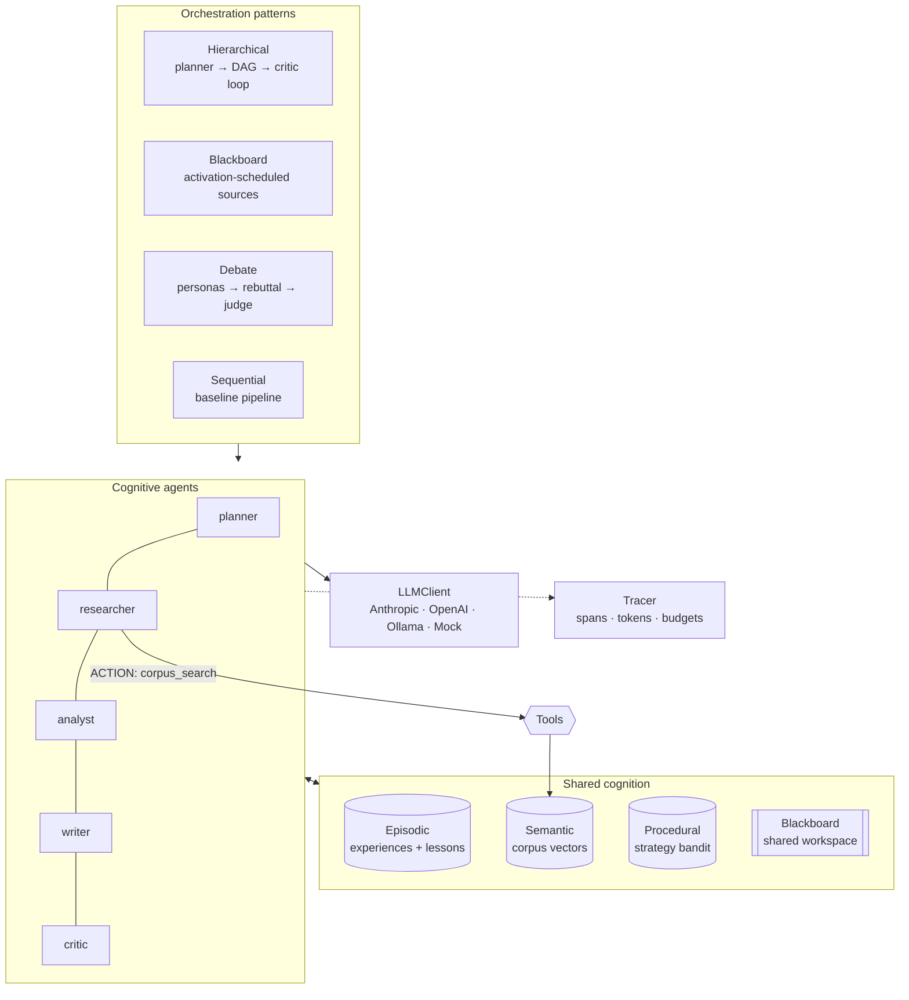
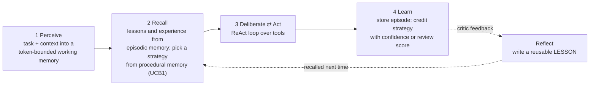
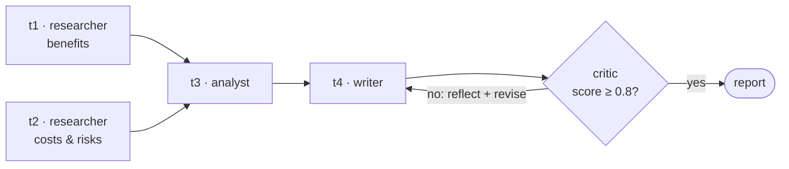
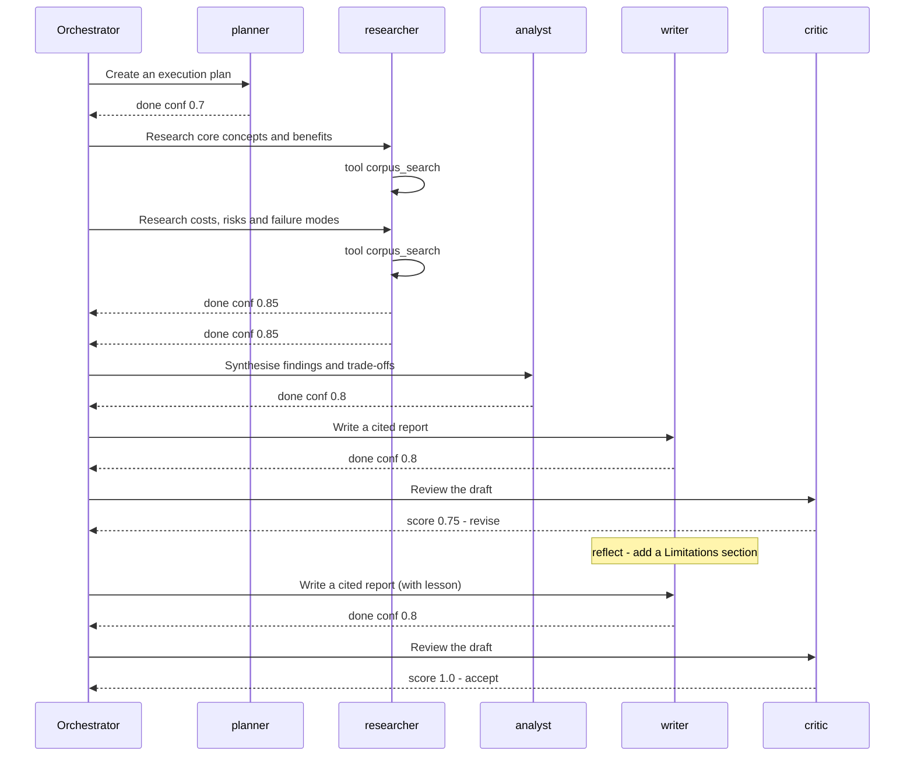

# cogniweave

**Multi-agent orchestration on a cognitive architecture — built from first principles, framework-agnostic, and runnable offline.**

[](https://github.com/gali-ai-engineer/cogniweave/actions/workflows/ci.yml)


Most agent demos are a prompt chain with a for-loop. `cogniweave` treats each agent as a small **cognitive system** — working memory with an attention budget, episodic / semantic / procedural long-term memory, a ReAct decision loop, metacognitive confidence and Reflexion-style learning — and then coordinates teams of them through **four interchangeable orchestration patterns**.

```bash
pip install -e ".[dev]"
cogniweave run --pattern hierarchical --usage    # no API key needed
```

---

## What it demonstrates

| Capability | Where | Why it matters |
|---|---|---|
| **DAG planning with self-repair** | `orchestration/hierarchical.py`, `plan.py` | LLM plans are validated (schema, unknown roles, cycles); errors are fed back to the planner, with a safe fallback plan |
| **Concurrent execution** | `orchestration/executor.py` | Independent tasks run in parallel as soon as their dependencies finish; per-task retries; a test proves wall-clock parallelism |
| **Blackboard control** | `orchestration/blackboard_pattern.py` | No fixed plan — knowledge sources bid with activation scores and control emerges from shared state (Hearsay-II) |
| **Multi-agent debate** | `orchestration/debate.py` | Persona agents argue, read each other and rebut; a judge aggregates (Du et al., 2023) |
| **Reflexion loop** | `core/agent.py` `reflect()` | Critic feedback becomes a stored lesson; the lesson is recalled on the next attempt *and the next run* |
| **Four-part memory (CoALA)** | `cognition/memory.py` | Working (token-budgeted, salience eviction) · Episodic (relevance + recency + importance) · Semantic (vector search) · Procedural (UCB1 strategy bandit) |
| **Metacognition** | `executor.py` | Low-confidence results automatically trigger a deeper follow-up instead of flowing downstream |
| **Grounded outputs** | `crew.py`, critic | Every claim carries a `[source#chunk]` citation; the critic rejects drafts without sources or limitations |
| **Guardrails & observability** | `core/tracing.py` | LLM-call and token budgets, retries with backoff, nested spans across asyncio tasks, JSON + Mermaid trace export |
| **Provider independence** | `llm/` | Anthropic, OpenAI, Ollama, or a deterministic mock behind one 1-method interface |
| **Framework interop** | `adapters/langgraph_adapter.py` | The same agents run inside a LangGraph `StateGraph` — the core doesn't depend on any framework |

---

## Architecture



### The cognitive cycle inside every agent



Working memory is the context window treated as a scarce resource: each item (context, lessons, past experience) has a salience, and the least salient items are evicted when the token budget is exceeded. Episodic recall scores memories as `w_rel·relevance + w_rec·0.5^(age/half_life) + w_imp·importance`, so a week-old lesson can outrank a trivial note from a minute ago.

---

## Orchestration patterns

All four patterns share the same agents, memory and tracer, so they can be compared on equal terms:

```text
$ python examples/01_quickstart.py
pattern        llm calls   tokens  review  revisions
hierarchical          11     7634    1.00          1
blackboard            11     7793    1.00          1
debate                 7     7214       -          0
sequential             4     2974       -          0
```

### Hierarchical — plan, execute in parallel, review

The planner emits a JSON DAG; `t1` and `t2` run concurrently, the analyst waits for both, the writer waits for the analyst, then the critic gates the result.



### Blackboard — control emerges from the data

Each knowledge source reports how useful it could be *right now*; the controller runs the highest bidder. The actual schedule from a run:

```text
decomposer → researcher → analyst → writer → critic → writer → critic
```

Questions trigger research, finished research triggers analysis, a draft triggers critique, and a "revise" critique re-activates the writer.

### Debate — reduce single-model bias

An advocate, a skeptic and a pragmatist answer from the same retrieved evidence, then read and rebut each other for N rounds before a judge delivers a cited verdict.

---

## It learns across runs

Long-term memory persists to JSON. In run 1 the critic rejects the first draft, the writer reflects and stores a lesson, then revises. In run 2 the lesson is recalled *before* drafting:

```text
$ python examples/02_learning_across_runs.py
run 1: pattern=hierarchical | llm_calls=11 | tokens=7634 | review_score=1.0 | revisions=1
        lessons in memory: ["Reviewers expect this up front - Add a '## Limitations' section ..."]
run 2: pattern=hierarchical | llm_calls=8 | tokens=6189 | review_score=1.0 | revisions=0
```

Same quality, 27% fewer LLM calls — without touching model weights. Inspect what was learned with `cogniweave memory`.

---

## Observability

Every agent run, LLM call, tool call, reflection and scheduling decision is a span (nesting is preserved across concurrent asyncio tasks via `contextvars`). Export with `--trace-out trace.json`, or render the run as a sequence diagram with `--mermaid` (simplified below):



`--usage` prints per-agent token accounting; `Tracer(max_llm_calls=..., max_tokens=...)` raises `BudgetExceeded` to stop runaway loops.

---

## Quickstart

```bash
git clone https://github.com/gali-ai-engineer/cogniweave && cd cogniweave
python -m venv .venv && source .venv/bin/activate
pip install -e ".[dev]"

make test                                  # 38 tests, offline, < 1 s
cogniweave run --pattern blackboard        # offline mock
cogniweave run "Your question" --pattern debate --mermaid
```

With real models (set keys from `.env.example`):

```bash
pip install -e ".[anthropic]"   # or [openai], [langgraph], [all]
cogniweave run "Should our support bot be multi-agent?" --provider anthropic --usage
cogniweave run "..." --provider ollama --model llama3.1   # fully local
```

Docker:

```bash
docker build -t cogniweave .
docker run --rm -e ANTHROPIC_API_KEY -v "$PWD/.cogniweave:/app/.cogniweave" cogniweave \
  run "Your question" --provider anthropic
```

### Use it as a library

```python
import asyncio
from cogniweave import get_llm, run_pattern, MemorySystem

memory = MemorySystem()
memory.load(".cogniweave/memory.json")
result = asyncio.run(run_pattern("hierarchical", "Your question", llm=get_llm("anthropic"), memory=memory))
memory.save(".cogniweave/memory.json")

print(result.answer, result.review, result.tracer.usage_table(), sep="\n\n")
```

Point the researcher at your own documents with `run_pattern(..., corpus_dir="path/to/markdown")`, add tools with the `@tool` decorator (see `examples/03_custom_agent_and_tool.py`), or run the workflow under LangGraph (`examples/04_langgraph.py`).

---

## Design decisions

- **Framework-agnostic core, adapter for LangGraph.** Orchestration logic is plain asyncio so the mechanics are visible and testable; LangGraph is offered as a drop-in control-flow backend for checkpointing and streaming.
- **Deterministic mock LLM.** The mock follows the same text protocols (ReAct `ACTION:` lines, JSON plans, JSON reviews, `CONFIDENCE:`) as real models, so CI exercises planning, tool use, repair, reflection and debate without API keys or flakiness.
- **One `LLMClient.complete()` method.** Adding a provider is ~30 lines; agents never import an SDK.
- **Zero runtime dependencies.** The core is pure Python (stdlib only), so it installs anywhere — including locked-down laptops where compiled extensions are blocked. LLM-produced plans and reviews are still strictly validated, with error messages written to be fed back to the model.
- **Errors are observations.** Tool exceptions are returned to the model as `ERROR: ...` so it can recover; LLM failures are retried with exponential backoff; budgets stop runaway runs.
- **Dependency-free embeddings by default.** A signed hashing embedder keeps the repo installable anywhere; any object with `embed(text) -> list[float]` can replace it.

## Project layout

```text
cogniweave/
├── llm/             base interface · Anthropic / OpenAI / Ollama · deterministic mock
├── cognition/       embeddings · working / episodic / semantic / procedural memory
├── core/            CognitiveAgent (ReAct + Reflexion) · tools · blackboard · tracing
├── orchestration/   plan DAG · executor · hierarchical · blackboard · debate · sequential
├── adapters/        LangGraph StateGraph adapter
├── data/corpus/     knowledge base used by the research demo
├── crew.py          research crew and debate panel factories
├── runner.py        run_pattern() — one entry point for every pattern
└── cli.py           `cogniweave run | memory`
examples/  tests/  docs/ARCHITECTURE.md
```

## Roadmap

- [ ] Evaluation harness: question set × patterns × providers, scored by an LLM judge, with cost/quality frontier plots
- [ ] Human-in-the-loop approval node for irreversible tool calls
- [ ] MCP tool adapter so agents can use any MCP server
- [ ] Episodic memory consolidation (summarise and expire old episodes)
- [ ] OpenTelemetry exporter for the tracer

## References

- Sumers, Yao, Narasimhan, Griffiths (2023). *Cognitive Architectures for Language Agents* (CoALA).
- Park et al. (2023). *Generative Agents: Interactive Simulacra of Human Behavior*.
- Shinn et al. (2023). *Reflexion: Language Agents with Verbal Reinforcement Learning*.
- Yao et al. (2022). *ReAct: Synergizing Reasoning and Acting in Language Models*.
- Du et al. (2023). *Improving Factuality and Reasoning in Language Models through Multiagent Debate*.
- Erman et al. (1980). *The Hearsay-II Speech-Understanding System* (blackboard architecture).
- Laird (2012). *The Soar Cognitive Architecture*; Anderson (2007). *How Can the Human Mind Occur in the Physical Universe?* (ACT-R).
- Auer, Cesa-Bianchi, Fischer (2002). *Finite-time Analysis of the Multiarmed Bandit Problem* (UCB1).

---

Built by [Bala Ajay Kumar Reddy Gali](https://github.com/gali-ai-engineer) — AI Engineer (GenAI, RAG, agentic systems). MIT licensed.
